




  <a href="https://github.com/xcrpty7/ai-tutor-backend"></a>
  
  
  


  <a href="https://github.com/xcrpty7/Savdo-E-"></a>
  <a href="https://github.com/xcrpty7/topex-texnikumi"></a>
  <a href="https://github.com/xcrpty7/maftravel-design"></a>
  <a href="https://github.com/xcrpty7/maxinaciya-portfolio"></a>








<b>Plain-text version</b>

**xcrpty7** is a full-stack and AI-agent developer from Tashkent, Uzbekistan, shipping production apps since 14. Speaks Uzbek, Russian and English.

- **AI Tutor**: a school AI tutor that leads students to the answer instead of solving their homework and resists prompt injection. Web, Telegram bot and Mini App. [Demo](https://ai-tutor-site-sable.vercel.app)
- **Jarvis** (private): a personal Telegram assistant that runs Claude Code agents. The model proposes, the code decides. Taking tools away from the model cut the cost per call from $0.17 to $0.02.
- **claude-kit-uz** (private): a one-click Claude Code booster for Uzbek-speaking developers on Windows: task router, BM25 RAG with Uzbek/Russian stemming, error memory on hooks.
- **KUCH** (private): a 3D commercial for a fictional energy-drink brand, built entirely from Python scripts in Blender.
- **Savdo-E**, **TOPEX Texnikumi**, **MafTravel**, **OSINT portfolio**: products and sites with open source code.

Every image on this page is hand-written SVG generated by [`scripts/`](scripts), with no third-party widgets.

