


<a href="#user-content-man"></a>
<a href="#user-content-projects"></a>
<a href="#user-content-agents"></a>
<a href="#user-content-journey"></a>
<a href="#user-content-stack"></a>
<a href="#user-content-stats"></a>




  <a href="https://ai-tutor-site-sable.vercel.app"></a>
  
  
  
  
  
  
  






<b>Plain-text version</b>

**xcrpty7** is a full-stack and AI-agent developer from Tashkent, Uzbekistan, shipping production apps since 14. Speaks Uzbek, Russian and English.

Builds AI agents that live in Telegram and do real work: the model talks, the code decides, and nothing is sent without an explicit yes. Ships web apps with auth, payments and admin panels that real businesses use. MVP in 3-7 days, security first, every claim backed by a test or a number, and every solved bug goes into memory so it happens only once.

- **AI Tutor**: a school AI tutor that leads students to the answer instead of solving their homework and resists prompt injection. Web, Telegram bot and Mini App. [Demo](https://ai-tutor-site-sable.vercel.app)
- **Jarvis** (private): a personal Telegram assistant that runs Claude Code agents. Taking tools away from the model cut the cost per call from $0.17 to $0.02.
- **claude-kit-uz** (private): a one-click Claude Code booster for Uzbek-speaking developers on Windows: task router, BM25 RAG with Uzbek/Russian stemming, error memory on hooks.
- **KUCH** (private): a 3D commercial for a fictional energy-drink brand, built entirely from Python scripts in Blender.
- **Moon & Mars on Earth** (NASA Space Apps): an interactive atlas of places on Earth that stand in for lunar and Martian conditions, with a six-criteria similarity index computed from open data.
- **Savdo-E** (private): a sales management platform for small and mid-size businesses, built with a team of five.
- **TOPEX Texnikumi**, **MafTravel**, **OSINT portfolio**: products and sites (private code).

Every image on this page is hand-written black-and-white SVG generated by [`scripts/`](scripts), with no third-party widgets and no JavaScript. The globe is ordered-dithered from [Natural Earth](https://www.naturalearthdata.com/) land data (public domain).

